# Nothing to Lose

A fan-made music video for [N U B](https://youtu.be/9Lxr8EW_TL0)'s song **Nothing to Lose** (uploaded as "Nothing to Lose – NUB | Royalty Free Aggressive Trap / Rap"), credited on the channel as N U B / nubarchive, released under Creative Commons Attribution (CC BY).

**The song and its rights belong to N U B.** This project is an unofficial fan music video. It is not affiliated with the artist, not endorsed by the artist, and claims no rights to the song. Thank you to N U B for releasing the track under CC BY.

Original song: [https://youtu.be/9Lxr8EW_TL0](https://youtu.be/9Lxr8EW_TL0)

## Make your own

This video was directed by a music-video bot built from the [Tempotage template](https://x.ai/bot/0MgEiSVzQaByzMurkhxSs). Anyone can start from the same template and make their own.

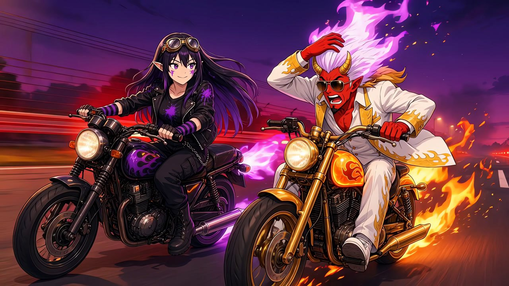

This write-up is a full, honest record of how the video was made: the timeline, the tools, the people and agents, the prompts we actually have, the generation counts, the 4K pass, the usage readings, and what we learned. Every number comes from a log, a progress file, or a usage report. Where a number was never recorded, this page says so instead of guessing. All times are Pacific Time (PT).

The method follows the stills-first approach used on SCREAM, Figuring it out, and I Don't Need Removal, itself a tighter method than the many-takes burn recorded in the [ARTAPOELC homage process post](https://github.com/littletechbird/artapoelc-homage-process). This is also the first of these videos cut under a new hard rule: no shot in the edit may be shorter than about 2 seconds, and the cut is scanned for flash frames before the 4K pass.

## Contents

- [Make your own](#make-your-own)
- [The finished piece](#the-finished-piece)
- [The story and the tone](#the-story-and-the-tone)
- [Timeline](#timeline)
- [Tools](#tools)
- [How a take was checked (LOOK)](#how-a-take-was-checked-look)
- [Agents and roles](#agents-and-roles)
- [Generation counts](#generation-counts)
- [4K stats](#4k-stats)
- [Prompts](#prompts)
- [Usage and tokens](#usage-and-tokens)
- [Lessons learned](#lessons-learned)
- [Privacy](#privacy)
- [Appendix A: shot plan v1](#appendix-a-shot-plan-v1)
- [Appendix B: the cut, 39 segments (v2)](#appendix-b-the-cut-39-segments-v2)
- [Appendix C: sample LOOK notes](#appendix-c-sample-look-notes)

## The finished piece

| | |
|---|---|
| Final file | `Nothing to Lose 4K.mp4`, in the folder `Nothing to Lose mv/4K`, on the home PC used for the upscale (an RTX 5060 Ti) |
| Picture | H.264 High, 3840×2160 (16:9), yuv420p, 24 fps, 5,972 frames, 248.833 s of picture, about 59.5 Mb/s |
| Length | 248.833 s (4:09), cut to the length of the song. The song master used for planning was logged at 248.83 s. |
| Audio | N U B's song, AAC LC 48 kHz stereo, about 266 kb/s, copied from the v2 review cut |
| Size | 1,860,154,274 bytes |
| SHA-256 | `de27da392844b1b12eadd8228525039534cebd061ec6afb0a6231ce9c1a066dd` |
| Approved cut, v2 (720p, with song) | 1280×720, 24 fps, 5,972 frames, 248.833 s, 390,485,679 bytes, SHA-256 `d6086e62f68d015556c7a461bbcad1fbf7294df29348994146033f56a5f403ea` |
| Silent master, v2 (720p) | 248.833 s, 382,119,172 bytes, SHA-256 `61ce26775d8edc519795aa4ccbadf19658437b2ad6e289519629be04d19ca0f2` |
| Song master (planning wav) | 48 kHz wav from the YouTube opus stream, SHA-256 `3cd402519d914aeabec1e8b9ed39a596c99c1704381389af298b1539df5eab4c` |

The picture was built silent first, then a separate copy had the song laid underneath for review. v2 is an edit of the same 40 motion clips, not a later recut with new generations: the builder dropped the first frame of every clip window (Grok Imagine image-to-video starts on the still) and closed a one-frame sliver at the head of shot 15. v1 was left in place. There was no later recut of the 4K master.

The thumbnail pick, shown at the top of this page, is the frame at 3:20.5 from the finished 4K master: VEX smirking as the King slaps at his burning pompadour.

N U B's official YouTube thumbnail for the song is below. VEX was redesigned from that goth-elf image: the crop top was covered with a moto jacket over a tee, and the open grin became a sly closed smirk.

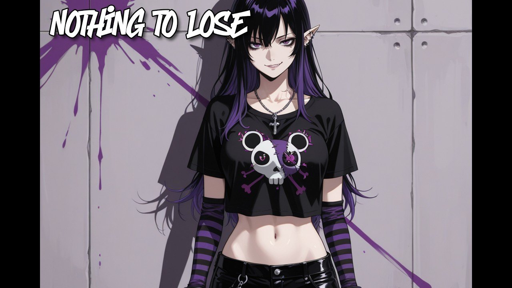

## The story and the tone

Last row, nothing to lose: a broke goth elf mechanic everybody calls crazy builds a junkyard motorbike, crashes the Demon King's rigged Inferno Grand Prix, turns her own pocket demons into her pit crew, and wins because she is the only racer with nothing to lose. Every dark line plays as cartoon-hell bravado. The demons are tiny and needy. The Demon King is a vain showman with a flammable pompadour. In the finale his hair catches fire, he hands over his singed crown, and she puts it on Littlebird.

The art direction was painterly cel-shaded anime, in the same look family as SCREAM, Figuring it out, and I Don't Need Removal: crisp ink linework, watercolor backgrounds, rim light. Two worlds: Low Row, her junkyard slum at the bottom of the underworld city (violet night, charcoal smoke, ember-orange glow), versus the Demon King's floating Inferno Arena (gaudy red and gold, a giant glowing gold crown). Her signature color is electric violet. The arc of light runs violet night, to arena glare, to ash-gray breakdown, to a violet-fire takeover, to an ember sunrise.

The lead, **VEX**, is an original adult, about 24, redesigned from the song thumbnail (a goth elf girl with a purple paint splatter). Long straight black hair with violet streaks and choppy bangs; pointed elf ears with a small silver hoop in the left ear; violet eyes; pale skin; a splash of violet paint across her right cheek; brass welding goggles pushed up on her head. A cropped black leather moto jacket, sleeves pushed up, over a plain black tee with a violet paint splatter and no logo, covering the thumbnail's crop top. Black-and-violet striped fingerless arm warmers, black cargo pants with a silver wallet chain, chunky black lace-up boots, and a big steel wrench with a violet-taped handle. Mouth closed; signature is a sly one-sided closed smirk and deadpan eyes. Two arms, five fingers per hand.

**The bike** is a scrappy matte-black junkyard motorbike of mismatched parts: one big round headlight, an exposed engine, violet flame paint on the tank, and an exhaust that spits violet fire. No text, no badges. **The imps**, from shot 04, are three fist-sized round violet imps with stubby horns, little bat wings, big yellow eyes, and only a small closed mouth line: needy, dramatic, loyal. **The Demon King**, from shot 07, is a tall vain showman: red skin, two curled gold horns, a huge glossy white pompadour, gold aviator sunglasses, a white suit with gold flame trim, and a gold chopper. Smug, never truly menacing, mouth closed. **Littlebird** appears from shot 27 as a shy pit-crew friend, in the same helmet-off design used on the earlier videos, person-sized, about Vex's shoulder height. His beak has to stay visible, in profile or three-quarter, so he never reads as a bear. Rivals, crowd, and neighbors are original adult demons and ghouls. Every human and humanoid is an adult.

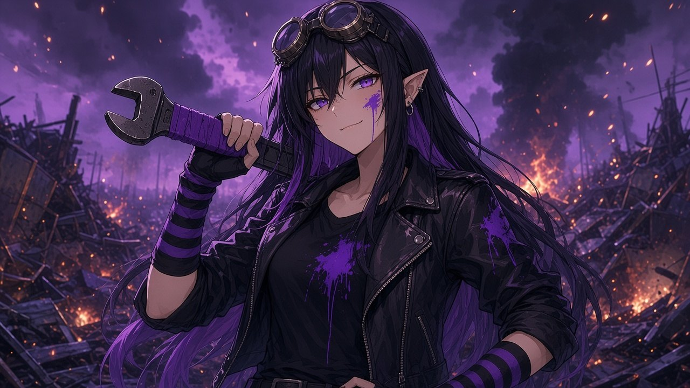

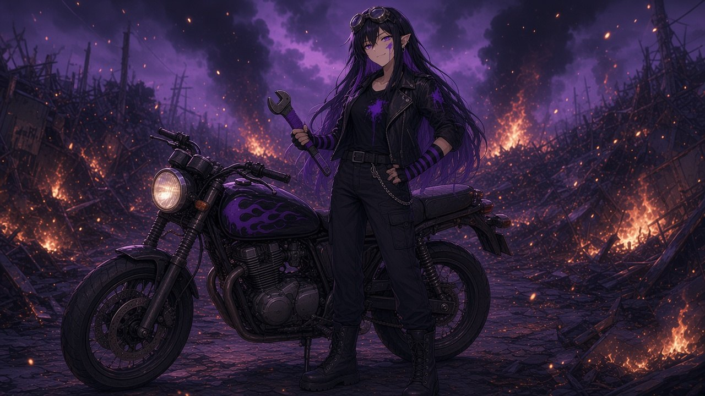

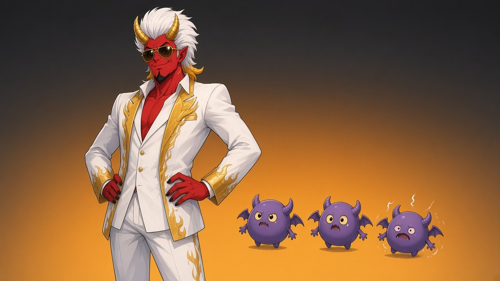

Littlebird's ref, reused from I Don't Need Removal:

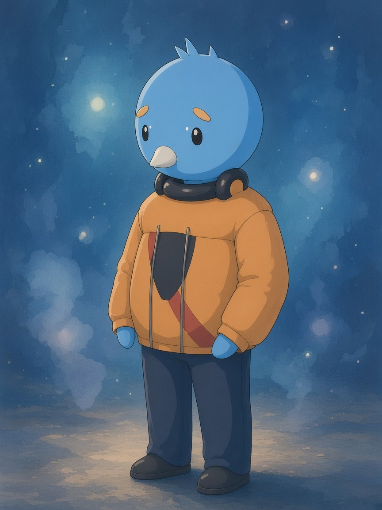

Method rules:

- One still per shot. The creator handed still approval, motion, the cut, and the 4K pass to the director ("all u"). Nothing was to be posted until the 4K was delivered.
- One 10 s 720p Grok Imagine image-to-video take per still; reshoot only failures, at most one reshoot per shot. Keep-partials were allowed.
- Cuts land on bar lines. The song maps at 138.26 BPM (a halftime trap feel, so the pulse reads as 69), with a bar of 1.7355 s from 0.048 s, and 144 bars. Shots were planned as 4 bars (about 6.94 s) or 3 bars (about 5.21 s) on the fast-rap runs, with the last shot taking the leftover into the end of the song.
- Mid-project, a new hard rule was added: no shot in the cut can be shorter than about 2 seconds, and the cut is scanned for flash-frame slivers before the 4K. The rule applies to this video and to new videos after it, not to already-published cuts.
- Motion law: no stills used as footage, no Ken Burns moves, no freeze frames, no reverse, no clip reused. In the v2 cut, the first frame of every clip window was dropped, because Grok Imagine image-to-video starts on the still.
- Mouths stay closed. No singing, rapping, or lip sync. No blood, gore, or real weapons (the wrench and pitchforks are cartoon props). No on-screen text, letters, numbers, logos, or readable signs. No photorealism, no midriff or fan-service. Vex keeps the elf ears, violet streaks, cheek splatter, goggles, cropped black jacket, and two arms. No minors.

## Timeline

### Saturday, November 14, morning: the brief, the plan, and the 2-second rule

- The creator sent the song link and asked whether the challenge was accepted. It is N U B's "Nothing to Lose," a 4:09 aggressive trap track, also CC BY. The director started a stills-first shot list with a fresh lead and a tongue-in-cheek edge, and first offered to bring the stills for approval. The creator said no: all of it was on the director, through to a finished 4K master. The written usage aim was about 1 to 1.5% of weekly usage per finished minute.
- A tip from the recent videos came next: a couple of very short clips, almost like a glitch, one second or less, including a flash in I Don't Need Removal and one in the ARTAPOELC homage, caused by leftover slivers at the cut points. From then on, no shot in a new cut could be shorter than about 2 seconds, and every edit would be scanned before the 4K. A scan already started on I Don't Need Removal was stopped when the creator said not to correct anything already published. The rule was locked as forward-only and added to this video while the stills were underway.
- **7:36 AM.** Work started. Weekly usage read **61.9%** (Ultra plan; the weekly limit resets Monday, November 16 at 3:10 PM PT). Stop rules: target about 1 to 1.5% per finished minute, soft stop 68%, hard stop 72%. The song master was pulled with yt-dlp (opus to a 48 kHz wav) and hashed. A local faster-whisper medium pass supplied the planning lyric, because the YouTube description has no lyrics, with word timestamps treated as ±0.5 s. A music map logged 138.26 BPM, a bar of 1.7355 s from 0.048 s, and 144 bars. Shot plan v1 was written at **7:40 AM**: 39 shots, cuts on bar lines, 4-bar or 3-bar lengths except the closer. The full table is in [Appendix A](#appendix-a-shot-plan-v1).
- Character refs: a Vex portrait, a Vex full-body sheet with the bike, and a combined imps-and-King sheet (3 gens, all passed). The imps' tiny mouths drew slightly open on the sheet, so motion prompts were written to keep them shut. The Littlebird ref was reused from I Don't Need Removal, with no new gen.
- Then one 16:9 still per shot, with the refs attached. Five stills were rejected and retaken: shot 29 once (she had merged onto the rival's bike, and the clock had Roman numerals), shot 32 three times (a second Vex as the pursuer; then a raised finger that could read as a rude gesture, twice), and shot 35 once (daytime blue sky and a readable-ish sign). Five other stills passed with a local blur and no new generation (a glyph-like wall sign, a red letter-like mark, a garbled sign, card pips, and poster glyphs). The 2-second rule was written into the progress log at **7:56 AM**, during the stills wave. Stills were self-approved around **8:00 AM**. Usage after the stills read **62.8%**.

### Saturday, November 14, 8:00 AM to mid-morning: motion, the v2 cut, and 4K

- Motion: one 10 s 720p image-to-video take per shot, six in parallel, audio stripped, with a contact sheet every 0.5 s and a freeze detect on each take. Thirty-eight of the 39 first takes passed, many as keep-partials. Shot 31 t1 failed: Vex laughs open-mouthed throughout, in autumn daylight. Shot 31 t2 passed, a closed-mouth smirk at night; a daylight flash in the first half-second was trimmed off. Motion total: 39 first takes + 1 reshoot = 40 video gens.
- **8:46 AM.** The edit resumed after an interrupt. No generations or upscale jobs were in flight. `timeline v1.json` kept every cut on the bar grid, with a single window per shot and no internal splits. The shortest planned shot is shot 39, at 4.04 s. Shots 21, 20, and 24 were graded toward night because of palette drift. The v1 silent cut and the review copy with the song were both 5,972 frames, 248.833 s. `freezedetect` and `blackdetect` were clean. A scene-change scan found 35 detections, all on the edit cuts except a one-frame sliver at 97.250 s, at the head of shot 15. The in-point of shot 15 was nudged later to close it.
- **v2, a few minutes later.** The builder was changed to drop frame 0 of every window, because Grok Imagine image-to-video starts on the still. `timeline v2.json` keeps the v1 windows. Both v2 cuts are 5,972 frames, 248.833 s, with the hashes in the table above. The sub-2-second scan on v2: 39 shots, shortest 4.041 s (shot 39), zero shots under 2 s. A scene-select pass found 27 detections, all on the edit cuts, minimum 4.041 s. A tighter scene detect still flagged 97.250 s; a frame LOOK of 97.15–97.36 s showed a continuous whip-pan inside shot 15, same angle, not a sliver. Freeze 0, black 0. A contact sheet every 2 s was LOOKed and passed. Shot 21 still reads a bit dusk-green after the grade, logged as an acceptable weak spot.
- Usage after motion and the edit read **68.4%**. The review copy with the song was copied to the home PC in 15 × 25 MB parts and hash-checked (390,485,679 bytes, SHA-256 as above).
- **8:57 AM.** The 4K runner launched on the home PC (an RTX 5060 Ti), detached, using a copy of the I Don't Need Removal runner: `realesr-animevideov3` ×3, x264 slow CRF 16, 5,972 frames, audio copied from the v2 review cut. At **9:04 AM** it had upscaled 1,200 of 5,972 frames (chunk 4 of 20), at about 85 s per 300-frame chunk. While it ran, the 720p project was copied as a tar in 29 × 25 MB parts; 88 of 88 manifest files matched.
- **9:26 AM.** The upscale of all 5,972 frames was done, and the x264 encode began. At **9:37 AM**, after a second interrupt, the encode was still running and was not restarted: 1,974 of 5,972 frames, at about 3 fps. At **9:59 AM** the 4K file was done: `Nothing to Lose 4K.mp4`, 1,860,154,274 bytes, hash as in the table above.
- A 4K LOOK passed: an every-8 s sheet (32 tiles, in story order, no black or broken frames); a native 1280×720 sharpness crop at 3:20 (crisp lines, no mush or ringing); and a second sub-2-second scan of the 4K, which passed the same way as v2. The thumbnail pick is the frame at 3:20.5, Vex smirking as the King slaps at his burning pompadour, saved as a 3840×2160 still next to the 4K. Temporary 4K work frames were kept.
- Usage at the end of the job read **68.8%**. Weak spots left for the creator to judge: one mid-song shot around 2:15 (shot 21) drifts to a dusk-green daytime look, the King and crowd show some toothy grins, and the opening shot is slow.

## Tools

| Tool | What it did here |
|---|---|
| yt-dlp and a local faster-whisper medium pass | The song master and planning timestamps. The YouTube description has no lyrics, so the whisper text is the planning lyric, treated as ±0.5 s. A music map logged 138.26 BPM, with a bar of 1.7355 s from 0.048 s, and 144 bars. |
| **GenerateImage** (Grok Imagine stills) | 3 new refs (Vex portrait, Vex full body with the bike, imps and King), 39 first stills, and 5 retakes (29 once, 32 three times, 35 once). The Littlebird ref was reused. Five passed stills also got a local blur and no new gen. |
| **Grok Imagine (GenerateVideo)** | Image-to-video, 10 s, 1280×720, from an approved still. 40 clips (39 first takes + 1 reshoot of shot 31). |
| ffmpeg / ffprobe | Contact sheets, keep-partial windows, dropping frame 0 of each window in v2, the hard-cut v1 and v2 rough cuts, laying the song under the picture, the 4K encode, `freezedetect`, `blackdetect`, scene-change scans, and stream probes. |
| Real-ESRGAN `realesr-animevideov3`, ×3, then x264 CRF 16 | The 4K upscale on the home RTX 5060 Ti: 1280×720 to 3840×2160. |
| PowerShell runner (`run 4K.ps1`) | The same resumable 4K pipeline used on the earlier videos: extract, upscale, encode to a file that is only finished when the encode completes. |
| SHA-256 manifests | Copies of the review cut and the 88-file project tar were hash-checked on the home PC. |

## How a take was checked (LOOK)

"LOOK" means a person-style visual check of the real frames before anything is called done.

**Per still:** each still was inspected before motion. Typical failures were a second Vex, a gesture that could be misread, a character merged onto the wrong bike, daytime palette drift, or readable marks. Five stills were repaired with a local blur instead of a new generation.

**Per motion take:** contact sheets every 0.5 s, plus freeze detect. Each take got PASS, KEEP-PARTIAL, or FAIL. The one full failure was an open-mouthed laugh in daylight (shot 31). Typical keep-partials were a late-clip palette drift, a morph jump, or a clean action that only lands in part of the ten seconds.

**Rough cut:** a contact sheet every 2 s; `freezedetect` and `blackdetect`, both clean; and a dedicated sub-2-second / flash scan (edit-list lengths, a scene-select pass, and a tighter scene detect), including a frame LOOK of the one leftover flag at 97.250 s.

**4K:** ffprobe (5,972 frames, 3840×2160, 24 fps, 248.833 s picture; AAC LC 48 kHz stereo, about 266 kb/s); an every-8 s sheet; a sharpness crop at 3:20; and the same sub-2-second scan run again on the 4K file. A PSNR of the 4K against the 720p cut was not logged.

## Agents and roles

| Agent | Role |
|---|---|
| **littletechbird** (human, the creator) | Creative lead. Handed still approval, motion, the cut, and the 4K pass to the director; added the 2-second minimum mid-project; and later uploaded the finished 4K. |
| **Director** (Tempotage, the video bot) | Wrote the shot plan, generated and LOOK-checked the stills and motion, built v1 and v2, launched the 4K pass, and did the 4K LOOK, including the flash scans. |
| **Compiler** | Compiled this public write-up from the production plan and progress logs. |

## Generation counts

| | Count |
|---|---|
| Shots in the plan and the cut | **39** |
| Character refs | **3** new (Vex portrait, Vex full body, imps and King). Littlebird reused, no new gen. |
| Per-shot stills, first pass | **39** first stills, plus **5** retakes (29 × 1, 32 × 3, 35 × 1) |
| Local blur fixes, no new gen | **5** (shots 05, 09, 11, 19, 23) |
| Image gens total | **47** |
| Motion | **40** (39 first takes + 1 reshoot: 31 t2) |
| Keep-partial windows in the v2 cut | 15 (3.0–9.9167), 18 (3.0–9.9167), 19 (3.0–9.9583), 20 (1.0–7.9583), 27 (4.5–9.7083), 28 (2.5–7.75), 30 (2.0–7.2083), 31 t2 (1.0–7.9167), 35 (2.0–7.2083), 39 (5.5–9.5403), and several shorter 3-bar slots that use the head of the take |
| Clip spec | 10 s, 1280×720, image-to-video |
| Shortest shot in the cut | **4.041 s** (shot 39). Zero shots under 2 s. |

5,972 frames at 24 fps are 248.833 s of picture.

## 4K stats

| | |
|---|---|
| Frames | 5,972 |
| Upscale speed (checkpoint) | about 85 s per 300-frame chunk at 9:04 AM (1,200 / 5,972 done). Upscale of all 5,972 frames finished 9:26 AM PT, **about 29 min** after the 8:57 AM start. |
| Encode | x264 CRF 16 slow, about 3 fps at the 9:37 AM checkpoint (1,974 / 5,972). Encode ran 9:26 to 9:59 AM PT, **about 33 min**. |
| Output | 3840×2160, 24 fps, H.264 High, x264 CRF 16, yuv420p, about 59.5 Mb/s |
| Audio | AAC LC 48 kHz stereo, copied, about 266 kb/s |
| Size / hash | 1,860,154,274 bytes, SHA-256 `de27da392844b1b12eadd8228525039534cebd061ec6afb0a6231ce9c1a066dd` |
| Temporary files left on disk | 4K work frames were kept. A total size for that folder was not logged. |

## Prompts

### Hero and character

The character lock in `plan.md` is the description the stills and motion prompts were built around. It is quoted in [The story and the tone](#the-story-and-the-tone).

Rules on every prompt, from the plan:

- mouth closed; Vex's signature is a sly one-sided closed smirk, not an open grin;
- no text, letters, numbers, logos, or readable signs (blank flags, blank cards);
- no blood, gore, or real weapons;
- no photorealism, no midriff or fan-service;
- Vex keeps the elf ears, violet streaks, cheek splatter, goggles, and cropped black jacket; two arms, five fingers per hand;
- Littlebird's beak stays visible in profile or three-quarter;
- every human and humanoid is an adult.

**Honest gap:** the exact text sent to GenerateImage and to Grok Imagine for each still and clip was **not saved to a file**. What was saved is the shot plan, plus the per-shot LOOK notes, including the retake briefs that the pursuer had to be the King (not a second Vex) and that the "come get me" beat had to be a hands-free wink over the shoulder. The prompts below are those plan lines, not verbatim API strings.

### Representative prompts (action text from the shot plan)

- **Junkyard wake (shot 01, 0:00):** "Low Row junkyard at night, violet fog, ember sparks, a half-open garage glowing violet; only Vex's boots stick out from under a bike on a creeper board." Beat: she rolls out, sits up, pushes her goggles up onto her head, deadpan. Used: `01 t1`, window 0–7.
- **Let's go (shot 04, 0:21, the drop):** "She kick-starts it; headlight blazes; violet fire spits from the exhaust and three tiny imps tumble out dizzy." Beat: catches one imp in her palm and tucks it into her jacket pocket. Used: `04 t1`. The still drew four imps, and some mouths were slightly open; the take plays as cartoon chaos and then the tuck-in.
- **Get up (shot 27, 2:57):** "Littlebird in his orange jacket jogs up through the ash with a toolbox, seen in three-quarter view." Beat: he offers his hand with a small shy nod; she looks up and takes it. Used: `27 t1`, window 4.5–9.7083, with the beak visible in the later crops.
- **Pompadour on fire (shot 31, 3:18, the one motion reshoot, and the thumbnail frame):** "Alongside the Demon King's gold chopper; her violet exhaust sets his pompadour on fire." Beat: she laughs, eyes squeezed shut, mouth closed, as he slaps at his flaming hair. The first take was an open-mouthed laugh in daylight. Used in the final cut: `31 t2`, window 1.0–7.9167. The thumbnail is 3:20.5 in this shot.
- **Still here (shot 38, 3:59):** "She plops the crown on Littlebird's head; it slips over his eyes; imps cheer." Beat: Vex grins at him, closed mouth. Used: `38 t1`, window 0–5.2083, Littlebird in three-quarter with the beak clear. In the still the crown sits on top rather than slipping over his eyes.

The full shot plan is [Appendix A](#appendix-a-shot-plan-v1). The v2 edit list is [Appendix B](#appendix-b-the-cut-39-segments-v2).

## Usage and tokens

**Plan:** Grok Bot Ultra. The weekly usage limit is shared with the other apps on the plan, so it isn't only Grok Bot. The limit reset Monday, November 16 at 3:10 PM PT. The written aim was about 1 to 1.5% per finished minute. Stop rules were a soft stop at 68%, with a hard stop at 72%.

**Weekly usage readings, from `progress.md`:**

| Time (PT) | Weekly usage | Source |
|---|---|---|
| 7:36 AM Nov 14 | 61.9% | before stills and motion (start of this project) |
| about 8:00 AM | 62.8% | after the 3 refs, 39 stills, and 5 still retakes, **before** motion |
| after motion and the v2 edit | 68.4% | after all 40 motion takes and the cut, **before** the 4K pass |
| 9:59 AM, when the 4K was done | 68.8% | final reading written for this project |

**Logged project usage:** 6.5 points of the weekly Ultra limit are directly attributable to logged generations (61.9% to 62.8% for the stills pass, then 62.8% to 68.4% for the 40 motion takes). That covers the 3 refs, the 39 first stills, the 5 still retakes, and all 40 motion gens, including the one reshoot. The 4K upscale itself does not spend this weekly generation budget. A further 0.4-point rise, from 68.4% to the final 68.8%, was logged after the edit, with no further generations written down for this project. Because the weekly limit is shared, that 0.4-point gap is **not attributed** here.

**Estimate, labeled as an estimate:** 6.5 points over a finished runtime of 248.833 s (4.15 minutes) is about **1.57% of weekly usage per minute of finished 4K**. If the unattributed 0.4-point gap is included, 6.9 points over the same runtime is about **1.66% per finished minute**, the figure written in the progress log at the end of the job. Both are a bit over the 1 to 1.5% target written at the start. These are estimates from the logged percentages and the runtime, not a metered per-clip cost.

This is the most complete usage log of the stills-first videos in this series: start, stills, post-motion, and final readings, with only one motion reshoot and no later generation recut of the master. The comparison is in the summary table that accompanies these write-ups.

**Raw token counts are not available.** No log or report used here records input or output tokens, per-clip generation cost, or a dollar figure, so none is estimated here. On-demand or extra-credit use was not logged for this project.

## Lessons learned

1. **A complete stills-first run, with only one motion reshoot and no later recut, landed at about 1.57% per finished minute on the attributable readings, or about 1.66% if a 0.4-point unattributed gap is counted.** That is a bit over the 1 to 1.5% target, and a bit higher than the clean SCREAM reading, but in the same neighborhood. The method held; the target was slightly optimistic.
2. **The 2-second minimum, plus a flash scan before 4K, is worth making a hard rule.** A one-frame sliver at the head of shot 15 would have been a glitch in the master. The scan found it in v1, and v2 closed it without regenerating anything. The rule is for new videos only; a scan already started on a published cut was stopped when the creator asked to leave those mistakes in.
3. **Grok Imagine image-to-video starts on the still.** Dropping frame 0 of every clip window keeps a freeze or a framing jump out of every cut. The v2 builder did this globally, and the length stayed 5,972 frames.
4. **Not every still failure needs a new generation.** Five readable marks were blurred locally and kept. The five actual retakes were identity, gesture, palette, or text problems that a blur could not fix.
5. **A raised finger is a high-risk gesture, and identity drift can turn a rival into a second lead.** Shot 32 took three retakes: first a second Vex on the King's bike, then two frames where a single raised finger could be misread. The beat was changed to a hands-free look-back wink, and the fourth still passed. Changing the action, and naming the King explicitly, was cheaper than hoping for a safer hand.
6. **Palette drift still leaks through a night grade.** Shot 21's still drew a daytime blue sky, the motion take flees into green daytime hills, and after a night grade it still reads dusk-green around 2:15. That was logged as a weak spot and left in, rather than spent on another generation.
7. **Crowd teeth are not the same as a lead open mouth.** Shot 31 was reshot because Vex laughed open-mouthed in daylight. The King's gritted grimace and a cheering crowd with open fangs were allowed, as long as they did not flap like lip sync.
8. **The Littlebird beak rule, learned on I Don't Need Removal, held on the first try.** Shots 27, 28, and 38 were prompted in three-quarter or with the beak called out, and none of them had to be regenerated for a bear read.
9. **Self-approval is faster, and it puts more weight on the still LOOK.** This video did not need a later character-fix recut, but the leftover nits (the dusk-green mid-song shot, some toothy grins, a slow opener) are still there for the creator to judge.
10. **Copy chunk size and a resumable 4K runner are settled lessons by this point.** 25 MB parts, plus a manifest, worked for the review cut and the 88-file project tar. At 9:37 AM the encode was still running and was not restarted. The output file is only finished when the encode completes. Keep the silent master separate, and leave big temporary files until the owner says so.

## Privacy

Folder names and short file names are shown, but this write-up does not include full file paths from a personal PC, machine IDs, or email addresses. The upscale machine is described as the home PC (an RTX 5060 Ti) used for the 4K pass. The creator is named as littletechbird.

---

## Appendix A: shot plan v1

From `plan.md`, the 39-shot plan the video was cut to. The preamble below is lightly edited from the production file so that local paths and personal names are not copied here. The shot table itself is the plan's table. Shot 32's beat in the table is the revised beat after the gesture retakes; the first plan line was a come-here gesture, dropped when a raised finger kept reading the wrong way.

Song: N U B, "Nothing to Lose – NUB | Royalty Free Aggressive Trap / Rap", CC BY, [https://youtu.be/9Lxr8EW_TL0](https://youtu.be/9Lxr8EW_TL0). The song master was logged at 248.83 s (4:09). Timing: local faster-whisper (medium), because the YouTube description has no lyrics, and a music map at 138.26 BPM, with a bar of 1.7355 s from 0.048 s, and 144 bars. All cuts were planned on bar lines. Shots were 4 bars (about 6.94 s) or 3 bars (about 5.21 s) on the fast-rap runs.

**Thesis, art direction, character lock, and anti-list:** as in [The story and the tone](#the-story-and-the-tone).

**Generation plan:** 3 refs, then 39 stills, one each, refs attached, regenerate only clear failures. Then 39 motion takes, 10 s 720p image-to-video, in parallel, with a maximum of one reshoot per shot and keep-partials allowed. Budget: 61.9% at the start, target about 1 to 1.5% per finished minute, soft stop 68%, hard stop 72%.

Key stills from the approved set, in story order:

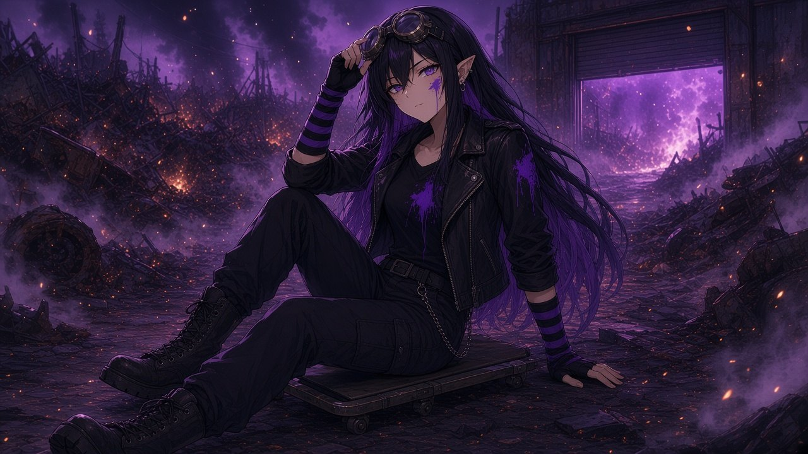

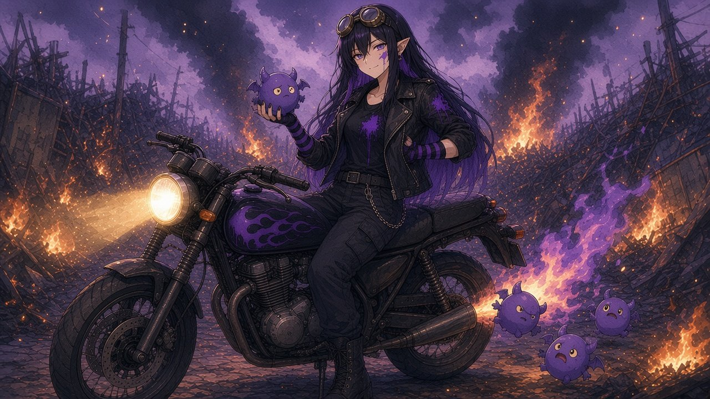

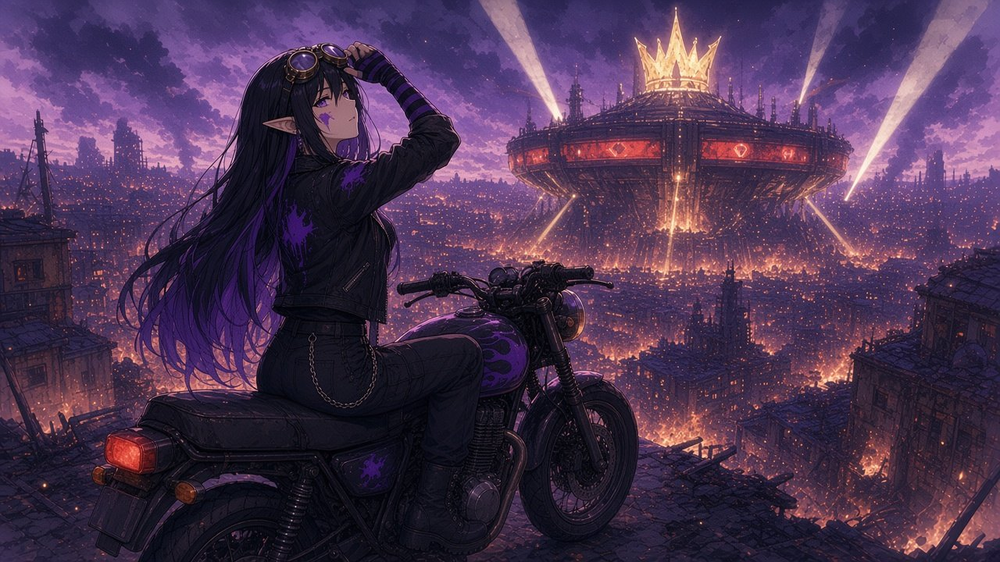

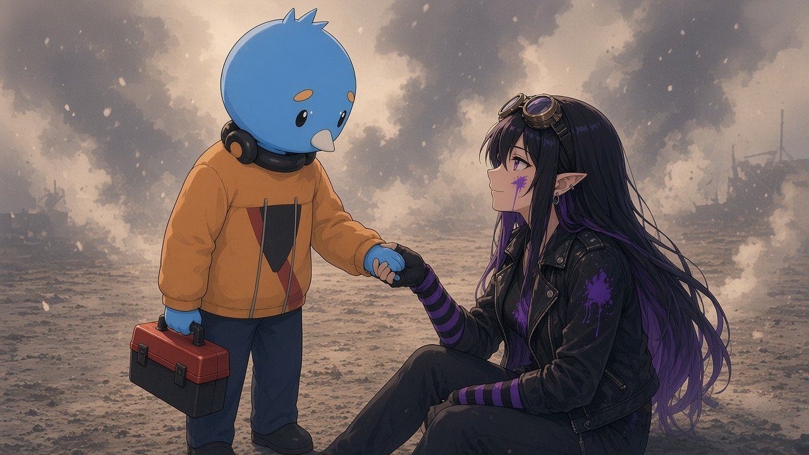

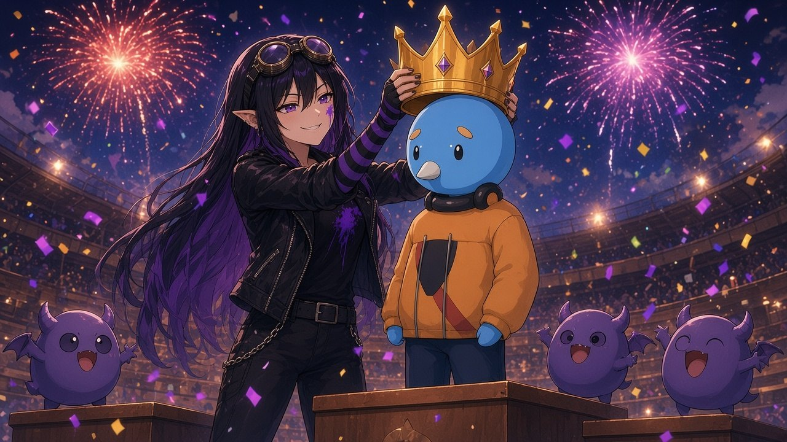

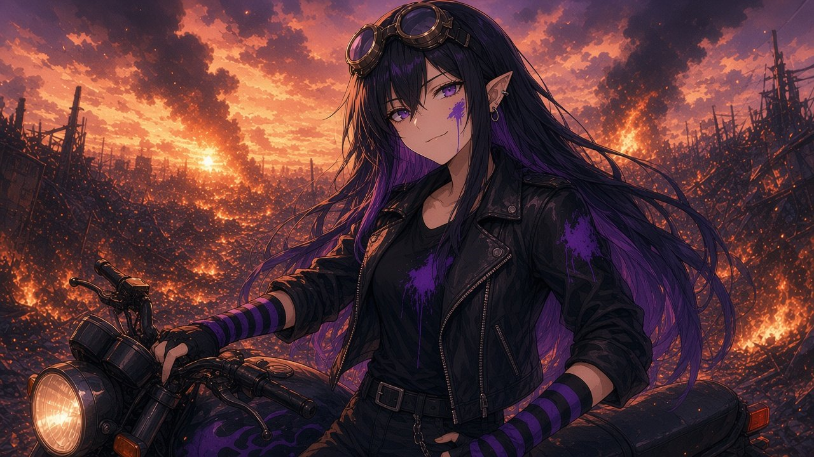

| # | Time | Lyric | Picture / action | Beat |
|---|------|-------|------------------|------|
| 01 | 0.00-6.99 | (intro) | Low Row junkyard at night, violet fog, ember sparks, a half-open garage glowing violet; only Vex's boots stick out from under a bike on a creeper board | She rolls out, sits up, pushes her goggles up onto her head, deadpan |
| 02 | 6.99-13.98 | They think I'm crazy, maybe I am | Gaunt gothic ghoul neighbors in nightcaps glare from crooked windows as sparks fly from her garage | Vex gives them a slow wave with the wrench and a smug little shrug |
| 03 | 13.98-20.92 | but you ain't seen the half of it | Garage: she whips a tarp off the junkyard bike, violet flame paint gleaming | Tarp flies, she leans on the bike, one eyebrow up |
| 04 | 20.92-27.86 | Let's go / they think I'm insane / went through the flames | She kick-starts it; headlight blazes; violet fire spits from the exhaust and three tiny imps tumble out dizzy | Catches one imp in her palm and tucks it into her jacket pocket |
| 05 | 27.86-34.80 | (beat) | Wheelie through narrow Low Row alleys past ember lanterns, imps clinging to the handlebars | Leans low over the tank, sly smirk |
| 06 | 34.80-41.73 | (beat, peak) | Rooftop edge: the colossal floating red-and-gold Inferno Arena above the city, crowned by a giant glowing gold crown, searchlights sweeping | Stops at the edge, flips goggles down, chin rises at the crown |
| 07 | 41.73-48.67 | (beat) | Arena gate: the Demon King at a gold podium laughs at her scrap bike among sleek red demon superbikes | She slaps a blank crumpled entry card on the podium and stares him down |
| 08 | 48.67-55.60 | Came from a place where pain makes a heart turn cold / staring at the sky | Lying on the tin roof of her tiny shack at the bottom of the city, the arena lights far above; little cartoon sparks pop around her head | Puffs her bangs out of her eyes with closed lips, restless |
| 09 | 55.60-62.52 | black hole in my chest / head full of ghosts / never said no | Cramped shack workshop: the three imps and two goofy little ghosts orbit her head like a mobile while she tightens a bolt | Swats a ghost away without looking, keeps working |
| 10 | 62.52-69.45 | barely in the cupboard / one pot but we still made supper / swore I'd be tougher | Tiny shack kitchen: one dented pot on a camp stove, imps on the counter holding tiny spoons | Gives the last spoonful to the smallest imp, then rolls up her sleeves |
| 11 | 69.45-76.39 | crawled through the fire, came out of the embers | Scrapyard test run: the bike bursts through a wall of violet flame | Rides out smoking, pats out a flame on her shoulder, unbothered |
| 12 | 76.39-83.32 | came from the bottom, climbing the ladder, kick down the door | A tall rickety iron ladder up the arena's outer wall over a dizzy drop | At the top she boots open a hatch door and light blasts out |
| 13 | 83.32-90.26 | talk all the shit, I'ma answer with pressure | Pit lane: horned rival racers in spiky leather jeer and point at her bike | She spins her wrench, revs once, the blast blows their hair back |
| 14 | 90.26-97.19 | fuck all the critics / flipping the switches / precision | Her bike's scrappy dashboard of toggle switches; behind her three sour gargoyle judges in bowties hold blank scorecards | Flips three switches in rhythm with precise fingers, never looking at the judges |
| 15 | 97.19-104.13 | adrenaline / pedal the metal, accelerating | Warm-up lap on a golden track spiraling around the arena, violet flame trail | Tucks low, speed lines |
| 16 | 104.13-109.33 | wait, you want speed, I'll give you speed | Starting grid: the Demon King on a gaudy gold chopper beside her | He blows her a mocking kiss; she slowly lowers her goggles |
| 17 | 109.33-114.53 | monster buried deep / claws at the cage | Close-up: the smallest imp pokes out of her jacket collar, fierce yellow eyes | She taps it back down with one finger; it pouts |
| 18 | 114.53-121.47 | feet on the ledge / staring at death / not yet | Start line at a cliff edge over a lava canyon, her front wheel over the drop, a blank skull-pattern flag falling | Peers down, then a sly grin and she launches |
| 19 | 121.47-128.42 | battling demons that nobody sees / chained in the basement / masterpiece | Her basement workshop: the three imps on tiny leashes sulking over a card game | She unclips them and hands each a tiny wrench; they perk up and salute |
| 20 | 128.42-135.36 | push me, prod me / calm till I'm not, then the switch gets flipped | Mid-race: two rival demons sandwich her bike, poking with cartoon pitchforks | Calm face, one eye twitches, she yanks a lever and an exhaust blast flings them off |
| 21 | 135.36-142.30 | fake smiles, fake friends / everybody wants fire till they stand in the flames | Rivals in grinning fake masks behind her; her flame trail lights the track; they flee off-road into the hills, tails smoking | Glances back with a smirk |
| 22 | 142.30-149.25 | I don't need approval / coming for the crown | The arena's giant gold crown monument on a central spire; she rides up its ramp | Plants one boot on the crown's rim, poses with the wrench on her shoulder |
| 23 | 149.25-156.20 | staring out windows, dreaming of escape | Memory: Vex in an oversized gray hoodie at a grimy shack window at night, arena lights far away | Chin on her fists, then draws a little bike in the window fog with a fingertip |
| 24 | 156.20-163.15 | gave it my soul / carried the load | She pushes the stalled bike uphill through falling ash, the three imps pushing behind | Jaw set, leaning into it |
| 25 | 163.15-170.10 | some days I wanna quit / the weight gets heavy | Breakdown: ash rain, her bike broken on the track shoulder, smoking engine; imps huddle under her jacket | She drops the wrench, slumps on the curb, head in her hands |
| 26 | 170.10-177.05 | some days the darkness gets louder | Rivals streak past in blurred light trails; the huge laughing shadow of the Demon King falls over her | She pulls her jacket collar up over her chin, eyes down |
| 27 | 177.05-182.26 | and I hear that voice: get up, get up | Littlebird in his orange jacket jogs up through the ash with a toolbox, seen in three-quarter view | He offers his hand with a small shy nod; she looks up and takes it |
| 28 | 182.26-187.48 | get back in the tac mode / black smoke | Littlebird and the imps swarm the engine in a burst of black smoke | Vex cracks her knuckles, swings onto the bike, goggles down |
| 29 | 187.48-192.69 | came from the last row, now I'm frontline / tick tock | She overtakes the pack under a giant gothic clock tower whose hands spin | Passes a rival with a two-finger salute |
| 30 | 192.69-197.90 | manic volcanic / attack in the panic | A volcano erupts beside the track; she jumps the bike through flying glowing rocks | Midair, focused, knees tight |
| 31 | 197.90-204.85 | faster than average / back with a vengeance / laughing | Alongside the Demon King's gold chopper; her violet exhaust sets his pompadour on fire | She laughs, eyes squeezed shut, mouth closed, as he slaps at his flaming hair |
| 32 | 204.85-210.07 | come get me | She pulls ahead, the furious King far behind | Looks back over her shoulder with a cocky wink and head tilt, hands on the bars |
| 33 | 210.07-215.28 | they think I'm insane / went through the flames just to keep you safe | Final straight: walls of fire close in | She hunches over the imps on the handlebars, shielding them |
| 34 | 215.28-220.50 | nothing to lose, nothing to save | She stands on the bike seat at full speed toward a blank checkered finish arch | Arms wide, eyes closed, fearless |
| 35 | 220.50-225.71 | nothing left, nothing left | Crosses the finish line a nose ahead of the King in a burst of violet fire and confetti | Skid-stop spin, dust ring |
| 36 | 225.71-232.66 | nothing to hide if the demons are calling / let them scream my name | The demon crowd goes wild, fists up, violet fireworks; the imps conduct them from her shoulders | Raises the wrench overhead |
| 37 | 232.66-239.60 | you think I'm insane / maybe | The singed Demon King, pompadour smoking with a bald patch, sulkily holds out the giant gold crown trophy | She weighs it in one hand, unimpressed |
| 38 | 239.60-244.81 | but I'm still here | She plops the crown on Littlebird's head; it slips over his eyes; imps cheer | Vex grins at him, closed mouth |
| 39 | 244.81-248.83 | (end) | Close-up on her bike at the arena edge, ember sunrise sky | Goggles up, sly smirk to camera, revs |

---

## Appendix B: the cut, 39 segments (v2)

From `timeline v2.json`. 1280×720, 24 fps, silent first, hard cuts only. Times are song time, in seconds. "Clip in / clip out" is the window taken from the source take, as written in the timeline file. The v2 builder then dropped frame 0 of every window (`trim` starting at `in × 24 + 1`), so the first frame of each shot in the file is motion, not the still. Shot 31 is the t2 reshoot. Shots 20 and 24 were given a light night grade, and shot 21 a night grade, because of palette drift.

| # | Song in | Song out | Dur | Clip | Clip in–out |
|---|---|---|---|---|---|
| 01 | 0.000 | 7.000 | 7.000 | 01 t1 | 0.0–7.0 |
| 02 | 7.000 | 14.000 | 7.000 | 02 t1 | 0.0–7.0 |
| 03 | 14.000 | 20.917 | 6.917 | 03 t1 | 0.0–6.9167 |
| 04 | 20.917 | 27.875 | 6.958 | 04 t1 | 0.0–6.9583 |
| 05 | 27.875 | 34.792 | 6.917 | 05 t1 | 0.0–6.9167 |
| 06 | 34.792 | 41.750 | 6.958 | 06 t1 | 0.0–6.9583 |
| 07 | 41.750 | 48.667 | 6.917 | 07 t1 | 0.0–6.9167 |
| 08 | 48.667 | 55.583 | 6.917 | 08 t1 | 0.0–6.9167 |
| 09 | 55.583 | 62.500 | 6.917 | 09 t1 | 0.0–6.9167 |
| 10 | 62.500 | 69.458 | 6.958 | 10 t1 | 0.0–6.9583 |
| 11 | 69.458 | 76.375 | 6.917 | 11 t1 | 0.0–6.9167 |
| 12 | 76.375 | 83.333 | 6.958 | 12 t1 | 0.0–6.9583 |
| 13 | 83.333 | 90.250 | 6.917 | 13 t1 | 0.0–6.9167 |
| 14 | 90.250 | 97.208 | 6.958 | 14 t1 | 0.0–6.9583 |
| 15 | 97.208 | 104.125 | 6.917 | 15 t1 | 3.0–9.9167 |
| 16 | 104.125 | 109.333 | 5.208 | 16 t1 | 0.0–5.2083 |
| 17 | 109.333 | 114.542 | 5.208 | 17 t1 | 0.0–5.2083 |
| 18 | 114.542 | 121.458 | 6.917 | 18 t1 | 3.0–9.9167 |
| 19 | 121.458 | 128.417 | 6.958 | 19 t1 | 3.0–9.9583 |
| 20 | 128.417 | 135.375 | 6.958 | 20 t1 | 1.0–7.9583 (nightlite grade) |
| 21 | 135.375 | 142.292 | 6.917 | 21 t1 | 0.0–6.9167 (night grade) |
| 22 | 142.292 | 149.250 | 6.958 | 22 t1 | 0.0–6.9583 |
| 23 | 149.250 | 156.208 | 6.958 | 23 t1 | 0.0–6.9583 |
| 24 | 156.208 | 163.167 | 6.958 | 24 t1 | 0.0–6.9583 (nightlite grade) |
| 25 | 163.167 | 170.083 | 6.917 | 25 t1 | 0.0–6.9167 |
| 26 | 170.083 | 177.042 | 6.958 | 26 t1 | 0.0–6.9583 |
| 27 | 177.042 | 182.250 | 5.208 | 27 t1 | 4.5–9.7083 |
| 28 | 182.250 | 187.500 | 5.250 | 28 t1 | 2.5–7.75 |
| 29 | 187.500 | 192.708 | 5.208 | 29 t1 | 0.0–5.2083 |
| 30 | 192.708 | 197.917 | 5.208 | 30 t1 | 2.0–7.2083 |
| 31 | 197.917 | 204.833 | 6.917 | 31 t2 | 1.0–7.9167 |
| 32 | 204.833 | 210.083 | 5.250 | 32 t1 | 0.0–5.25 |
| 33 | 210.083 | 215.292 | 5.208 | 33 t1 | 0.0–5.2083 |
| 34 | 215.292 | 220.500 | 5.208 | 34 t1 | 0.0–5.2083 |
| 35 | 220.500 | 225.708 | 5.208 | 35 t1 | 2.0–7.2083 |
| 36 | 225.708 | 232.667 | 6.958 | 36 t1 | 0.0–6.9583 |
| 37 | 232.667 | 239.583 | 6.917 | 37 t1 | 0.0–6.9167 |
| 38 | 239.583 | 244.792 | 5.208 | 38 t1 | 0.0–5.2083 |
| 39 | 244.792 | 248.832 | 4.040 | 39 t1 | 5.5–9.5403 |

Both v2 cuts were logged at 248.833 s (5,972 frames). `freezedetect` and `blackdetect` were clean. The shortest shot is 4.041 s. No stretch, no freeze, no reverse, no Ken Burns. No later generation recut of this master.

---

## Appendix C: sample LOOK notes

From `progress.md`. This is a sample, not a substitute for the full log.

**Stills, rejected and then passed:**

- **29 t1, rejected:** she merged onto the rival's bike, the clock had Roman numerals, and the sky was daytime blue. **t2, PASS:** separate bikes, a two-finger salute, violet night; the clock face has small tick marks and no readable numerals.
- **32 t1, rejected (identity):** the pursuer drew as a second Vex on the gold bike. **t2 and t3, rejected (gesture):** a single raised finger could be misread; t3 also had a daytime sky. The beat was changed to a hands-free look-back wink. **t4, PASS:** hands on the bars, wink over her shoulder, the furious King behind, night.
- **35 t1, rejected:** daytime blue sky, a readable-ish sign, the King with an open mouth. **t2, PASS:** night, a blank checkered arch, confetti, violet fire. Vex grins with teeth, and the King is shocked with an open mouth; motion was written to keep those jaws still.

**Local blur fixes, no new gen (raws kept):** 05, a glyph-like wall sign; 09, a red letter-like mark; 11, a garbled sign at top left; 19, card pips; 23, poster glyphs.

**Motion, the one reshoot and the keep-partials that shaped the cut:**

- **15 t1, KEEP-PARTIAL:** a direction or morph jump at 2.5–3.0 s. Window 3.0–9.9167. In v1, a one-frame sliver at 97.250 s was closed by nudging the in-point, then by dropping frame 0 of every window in v2.
- **20 t1, KEEP-PARTIAL:** the blast works; the sky turns day-blue after 8.5 s. Window 1.0–7.9583, with a light night grade.
- **21 t1, PASS with note:** rivals flee into green daytime hills, a palette drift already in the still. After a night grade it still reads a bit dusk-green. Left as a weak spot.
- **27 t1, KEEP-PARTIAL:** Littlebird helps her up; the beak is visible in the 5–9.5 s crops. Window 4.5–9.7083.
- **31 t1, FAIL:** Vex laughs open-mouthed throughout, autumn daylight. **31 t2, PASS:** closed-mouth smirk, night, the King slaps his flaming hair with a gritted grimace and no lip flap. A daylight flash in 0–0.5 s was trimmed. Window 1.0–7.9167.
- **39 t1, KEEP-PARTIAL:** the sunrise ride-up is in the tail of the take. Window 5.5–9.5403, the shortest slot in the cut, still 4.041 s.

**4K LOOK nits left for the creator:** the mid-song dusk-green drift around 2:15, some toothy grins on the King and the crowd, and a slow opening shot. The 3:20.5 thumbnail frame passed as a sharpness crop.
